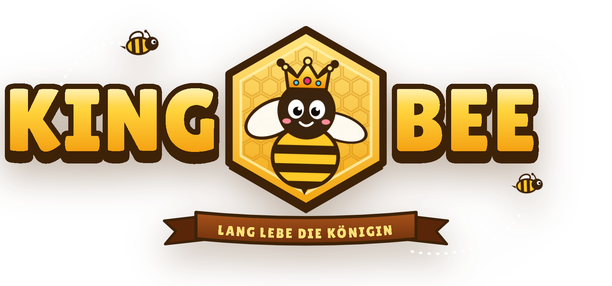
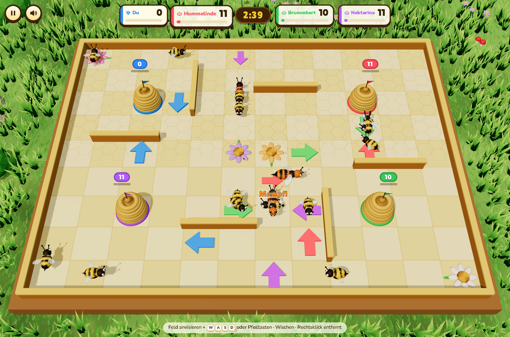
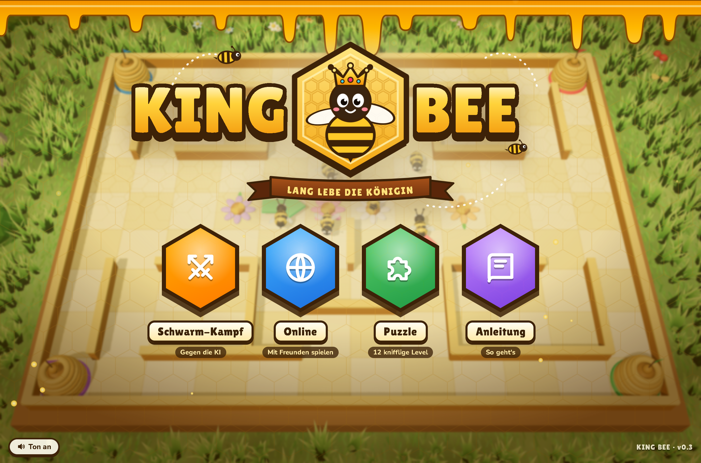
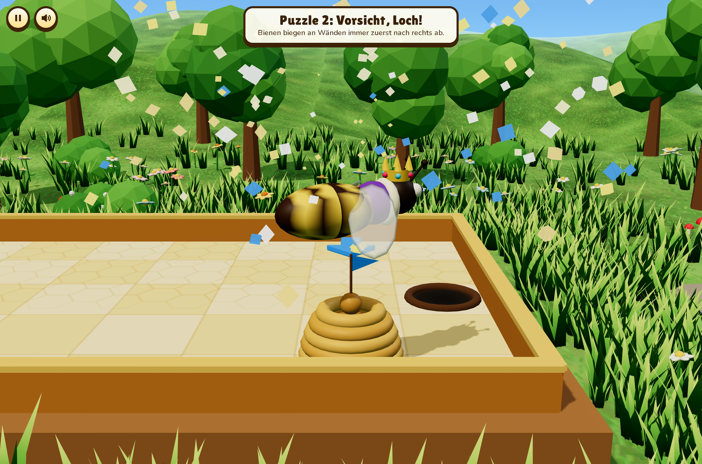
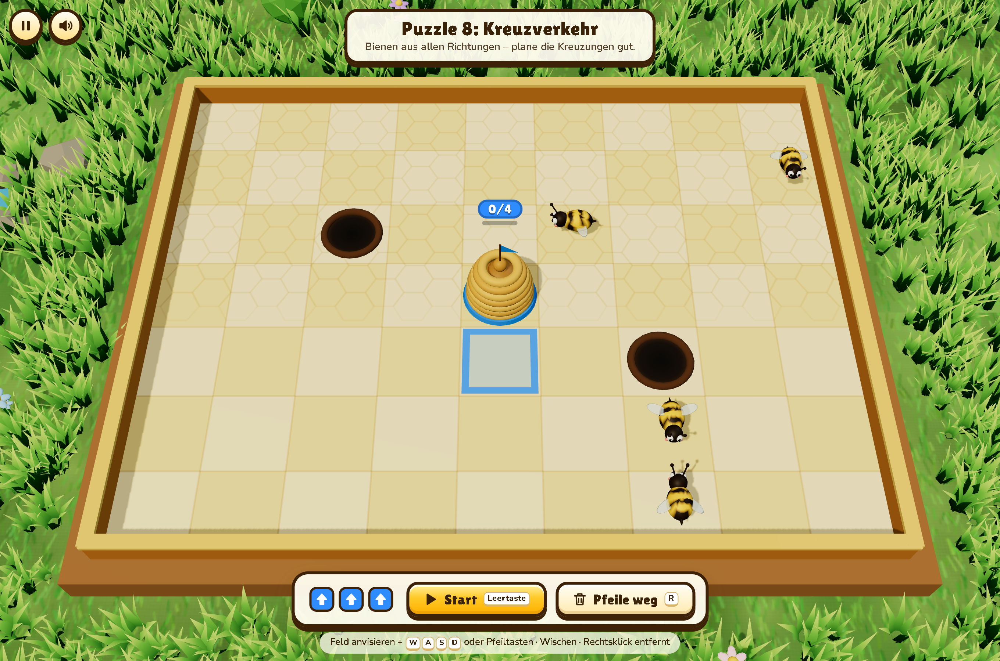
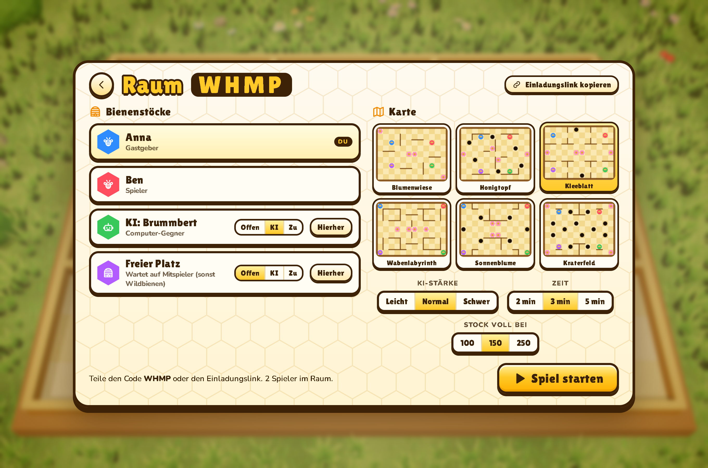
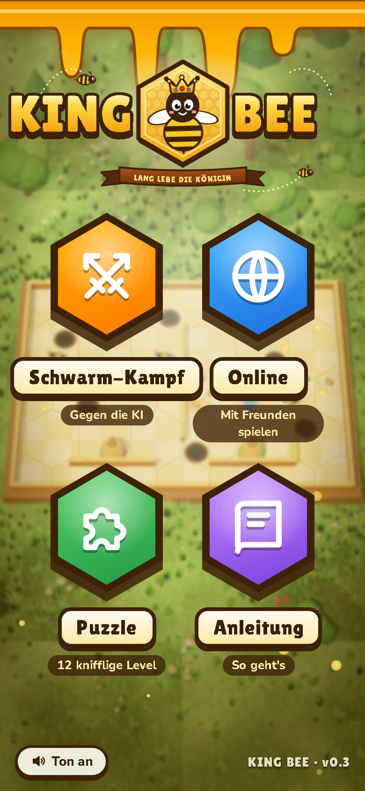
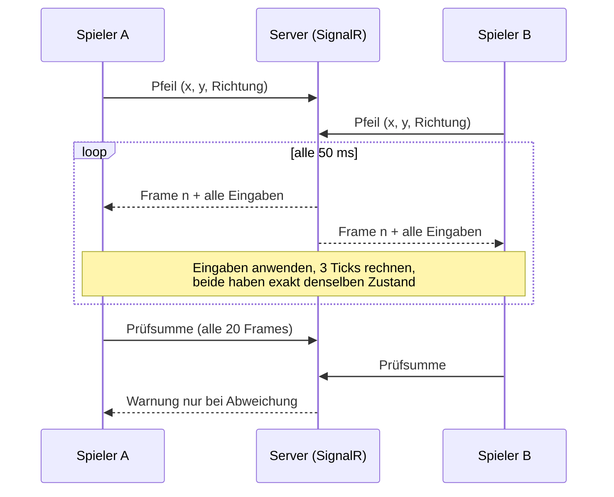

<div align="center">



### Lenke den Schwarm. Füll deinen Stock. Lass die Königin schlüpfen.

Ein schnelles 3D-Strategiespiel im Browser: Hunderte Bienen schwirren über das Spielfeld,
du lenkst sie mit Pfeilen in deinen Bienenstock und schickst die Hornissen zur Konkurrenz.
Ist dein Stock voll, **schlüpft die neue Königin**.

[](https://github.com/Real-TTX/KingBee/actions/workflows/docker-image.yml)




</div>

---

## Was ist King Bee?

Aus Blüten schwärmen ununterbrochen Bienen. Sie fliegen stur geradeaus und biegen an Wänden ab.
Du hast nur **drei Pfeile**, um den Strom umzuleiten, und deine Gegner haben auch drei.
Wer die meisten Bienen in seinen Stock lotst, gewinnt. Wer eine Hornisse in den Stock lässt, verliert ein Drittel seines Volkes.

<table>
<tr>
<td width="50%"></td>
<td width="50%"></td>
</tr>
<tr>
<td align="center"><b>Hauptmenü</b>: die KI spielt im Hintergrund schon mal vor</td>
<td align="center"><b>Sieg</b>: die neue Königin schlüpft aus deinem Stock</td>
</tr>
<tr>
<td width="50%"></td>
<td width="50%"></td>
</tr>
<tr>
<td align="center"><b>Puzzle</b>: 12 Level, jedes per Solver als lösbar geprüft</td>
<td align="center"><b>Online</b>: Raum erstellen, Code teilen, losspielen</td>
</tr>
</table>

## Spielmodi

| Modus | Worum geht's |
|---|---|
| **Schwarm-Kampf** | Du gegen 1–3 KI-Gegner (Leicht / Normal / Schwer) auf 6 Karten. Erster mit vollem Stock gewinnt, sonst der Führende bei Zeitende. |
| **Solo** | Fülle deinen Stock, bevor die Zeit abläuft. Die anderen Stöcke gehören Wildbienen. |
| **Online** | Bis zu 4 Spieler, freie Plätze mit KI auffüllen. Beitritt per 4-Buchstaben-Code oder Einladungslink. |
| **Puzzle** | Pfeile legen, Start drücken: Jede Biene muss heim, keine darf gefressen werden. 12 Level mit steigender Schwierigkeit. |

## Die Regeln in 30 Sekunden

- **Bienen** fliegen geradeaus. An einer Wand biegen sie **rechts** ab, sonst links, sonst kehren sie um.
- **Pfeile** schicken alles, was darüber fliegt, in ihre Richtung. Jeder hat 3, ein vierter ersetzt den ältesten.
- **Hornissen** fressen Bienen und beschädigen Pfeile. Erreicht eine einen Stock, verliert der Besitzer **ein Drittel** seiner Bienen.
- **Löcher** verschlucken alles, was hineinfliegt.
- **Goldbienen** zählen 10 Punkte. **Blütenbienen** (rosa) bringen einen Bonus: Nektar, Raubzug, Wachsschild oder Duftspur.

### Wellen

Alle 20–30 Sekunden dreht sich das Ereignis-Rad:

| Welle | Effekt |
|---|---|
| Schwarmzeit | Die Blüten sprudeln über vor Bienen |
| Hornissen-Alarm | Ein ganzes Nest fliegt aus |
| Rückenwind / Honigregen | Alles wird schneller bzw. klebrig langsam |
| Goldfieber | Viele Goldbienen |
| Windstoß | Alle Pfeile werden weggeweht |
| Imker-Rauch | Alle Hornissen verschwinden |
| Wirbelwind | Alle Tiere drehen um |

### Steuerung

| Aktion | Maus / Tastatur | Touch |
|---|---|---|
| Pfeil legen | Feld anvisieren + <kbd>W</kbd><kbd>A</kbd><kbd>S</kbd><kbd>D</kbd> oder Pfeiltasten | Über das Feld wischen |
| Pfeil drehen | Klick auf eigenen Pfeil | Tippen |
| Pfeil entfernen | Rechtsklick | – |
| Puzzle starten / stoppen | <kbd>Leertaste</kbd> | Button |
| Pause / Ton | <kbd>Esc</kbd> / <kbd>M</kbd> | Buttons |

<div align="center">

<br><sub>Läuft auch auf dem Handy</sub>
</div>

## Schnellstart

**Fertiges Image** (wird bei jedem Push auf `main` gebaut, für amd64 und arm64):

```bash
docker run -d --name kingbee -p 7461:8080 ghcr.io/real-ttx/kingbee:latest
```

**Selbst bauen** mit Docker Compose:

```bash
docker compose up -d --build        # http://localhost:7461
KINGBEE_PORT=7500 docker compose up -d   # anderer Port
```

Mitspieler im selben Netz öffnen `http://<IP-dieses-Rechners>:7461`, gehen auf **Online** und treten mit dem Raum-Code bei.

**Entwicklung:**

```bash
npm install
npm run dev                                   # Frontend mit Hot Reload (Vite)
dotnet run --project server/KingBee.Server    # Backend auf :5080, Vite leitet /api und /hubs dorthin
```

## Wie der Multiplayer funktioniert

King Bee nutzt **deterministischen Lockstep**. Die Simulation (inklusive KI) rechnet ausschließlich mit
Ganzzahlen und einem Zufallsgenerator mit gemeinsamem Startwert. Deshalb muss der Server das Spiel nicht
selbst simulieren: Er ist nur der **Taktgeber**.



Das hält den Server winzig, der Netzwerkverkehr ist minimal (nur Pfeil-Eingaben) und alle sehen garantiert dasselbe Spiel.
Ein Test prüft, dass zwei unabhängige Clients über tausende Frames bit-identisch bleiben.

## Qualität & Werkzeuge

```bash
npm run verify                          # Solver prüft jedes Puzzle: lösbar und nicht mit weniger Pfeilen
node tools/test-lockstep.mjs            # zwei Clients müssen bit-identisch bleiben
node tools/sim-battle.mjs normal        # KI gegen KI auf allen Karten (Balancing)
node tools/gen-puzzle.mjs 12 40 5 2 3   # sucht knifflige Startaufstellungen für ein Puzzle
```

Die GitHub Action führt Verifier, Lockstep-Test und beide Builds aus und veröffentlicht danach das Multi-Arch-Image auf `ghcr.io`.

## Projektaufbau

```
src/
  game/       Spiellogik ohne Grafik: Simulation, Kampf + Wellen, KI, Puzzles, Karten, Lockstep
  render/     Three.js: Szene, Modelle, Landschaft, Partikel, Schlüpf-Sequenz
  ui/         SVG-Logo, Icon-Set, Karten-Vorschau
  main.js     Menüs, Online-Lobby, HUD, Eingabe, Game-Loop
  net.js      SignalR-Verbindung
server/KingBee.Server/
  Multiplayer/GameHub.cs     Räume, Plätze, Start, Eingaben, Prüfsummen
  Multiplayer/FrameLoop.cs   der 50-ms-Takt
  Program.cs                 liefert das Spiel aus, /api/health, /hubs/game
tools/        Solver, Generator, Tests
```

**Technik:** Three.js · Vite · WebAudio (alle Sounds werden live erzeugt, keine Audiodateien) ·
ASP.NET Core 10 · SignalR · Docker (Multi-Stage, amd64 + arm64)

<div align="center">
<br>
<sub>Lang lebe die Königin.</sub>
</div>
